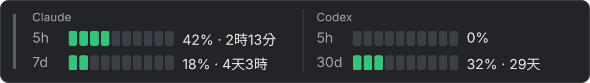

# Claude Usage Tracker（用量監控）

[English](README.md) | **繁體中文**

Windows 工作列上方的浮動小工具，顯示 **Claude**（Pro／Max 訂閱）與 **Codex**（ChatGPT 帳號）的用量百分比與重置倒數，也支援 Claude 桌面版。

> 本專案為非官方工具，與 Anthropic、OpenAI 無關；Claude、ChatGPT、Codex 為其各自擁有者的商標。

```
┃ Claude                          │ Codex
┃ 5h  ■■■■□□□□□□  42% · 2時13分   │ 5h  □□□□□□□□□□  0%
┃ 7d  ■■□□□□□□□□  18% · 4天3時    │ 30d ■■■□□□□□□□  32% · 29天
```



- 綠色 < 70%、黃色 70–89%、紅色 ≥ 90%；滑鼠停在小工具上會顯示確切的重置時刻
- 儀表板「用量」頁：過去 7 天的 5 小時用量、每個 7 天（或 30 天）週期的最高用量，以及最近的平均
- 系統匣圖示（小工具隱藏時看這裡）、全螢幕時自動隱藏、`Ctrl+Alt+U` 顯示／隱藏
- 支援 **Microsoft Store 版 Claude 桌面版**（資料在 `%LOCALAPPDATA%\Claude-Data\`）
- 繁體中文／English，預設跟隨 Windows

## 安裝

1. 到 [Releases](https://github.com/kdwjzh/windows-claude-tracker/releases) 下載最新版的：
   - `ClaudeUsageTracker-vX.Y.Z.exe`（主程式）
   - 可用 `SHA256SUMS.txt` 核對檔案：`Get-FileHash .\ClaudeUsageTracker-vX.Y.Z.exe`
2. 把 exe 放在固定的資料夾（例如 `%LOCALAPPDATA%\Programs\ClaudeUsageTracker\`），雙擊執行
3. 工作列右側上方會出現小工具，系統匣也會有圖示；右鍵 →「開啟儀表板」可開啟開機時啟動

需求：Windows 10／11（64 位元）。**請用一般使用者身分執行**，不要用系統管理員：桌面版的 token 用 Windows DPAPI 加密，只有登入的那個使用者解得開。

第一次執行時，Windows SmartScreen 可能顯示「Windows 已保護您的電腦」（exe 沒有程式碼簽章）：按「其他資訊」→「仍要執行」。

### 更新到新版

有新版本時，系統匣圖示右下角會出現藍點、系統匣選單最上面會多一行「有新版本 vX.Y.Z →」，並跳出一次通知（設定 → 關於也看得到）。程式不會自己下載或安裝，點了只會開啟 Release 頁面。

結束舊版（系統匣右鍵 →「結束」）→ 下載新版 exe → 執行。設定會沿用，「開機時啟動」也會自動改成指向新的 exe。

### 解除安裝

1. 設定 →「開機時啟動」關閉，然後結束程式
2. 刪除 exe
3. 刪除設定與 log：`%APPDATA%\MyUsageMonitor\`

## 資料從哪裡來

| 服務 | token 來源 | 用量 API |
| --- | --- | --- |
| Claude | ① Claude Code CLI：`%USERPROFILE%\.claude\.credentials.json`（未過期才用）<br>② Claude 桌面版：`%LOCALAPPDATA%\Claude-Data\claude_*`、`%APPDATA%\Claude\`、Store 版舊路徑 | `api.anthropic.com/api/oauth/usage` |
| Codex | `%USERPROFILE%\.codex\auth.json`（或 `%CODEX_HOME%`） | `chatgpt.com/backend-api/wham/usage` |

隱私與安全：

- 只**讀取**這些檔案，從不修改，也從不使用 refresh token（不會讓官方 App 被登出）
- token 只送到 `api.anthropic.com` 與 `chatgpt.com`；不寫進 log、設定檔或任何地方
- 用量歷史（`%APPDATA%\MyUsageMonitor\history.db`）只存每次更新的百分比與時間，保留 90 天，只在你的電腦上；設定 → 進階 →「清除用量歷史」可以刪除
- 預設每 5 分鐘查一次；這些用量 API 沒有公開文件，格式改變時可能暫時顯示不出來

## 設定檔

位置：`%APPDATA%\MyUsageMonitor\settings.json`。建議用設定視窗修改（改了立即生效）；手動修改需重開程式。格式錯誤時程式會用預設值啟動，原檔另存為 `settings.json.broken`。

| 欄位 | 預設 | 說明 |
| --- | --- | --- |
| `interval_minutes` | `5` | 更新間隔（分鐘），1–1440 |
| `providers` | `["claude"]` | 要顯示的服務：`"claude"`、`"codex"` |
| `allow_cli_refresh` | `false` | Claude Code CLI 的 token 過期、且沒有其他可用登入時，執行 `claude -p . --no-session-persistence` 讓 CLI 自己更新（會用掉少量額度，最多 30 分鐘一次，需 Claude Code ≥ 2.0.63） |
| `language` | `"system"` | `"system"`（跟隨 Windows）、`"zh-TW"`、`"en"` |
| `tray_icon` | `"auto"` | 系統匣圖示畫哪個監控對象：`"auto"`（最近用量有增加的；剛開程式時，先畫同時有 5h 與 7d 額度中用量最高的）、`"claude"` 或 `"codex"`；選的監控對象沒啟用時畫第一個啟用的 |
| `widget.visible` | `true` | 顯示小工具 |
| `widget.locked` | `false` | 鎖定位置（不能拖曳） |
| `widget.opacity` | `0.9` | 背景不透明度，0.3–1.0 |
| `widget.screen`／`widget.pos` | `null` | 小工具所在螢幕與相對位置；`null` 表示預設位置（工作區右下角） |
| `widget.hide_on_fullscreen` | `true` | 全螢幕看影片、玩遊戲時自動隱藏 |
| `widget.hotkey` | `"Ctrl+Alt+U"` | 顯示／隱藏快捷鍵（修飾鍵＋A–Z／0–9／F1–F24） |
| `widget.theme` | `"system"` | `"system"`（跟隨 Windows）、`"dark"`、`"light"` |
| `update_check.enabled` | `true` | 啟動 30 秒後與每 24 小時查一次 GitHub 上的最新版本（只連 `api.github.com`，不傳送任何個人資料）；關閉後只有在「關於」頁按「檢查更新」才會查 |
| `update_check.skipped_version` | `null` | 「略過這個版本」記下的版本，該版本不再提醒 |
| `update_check.last_checked_at`／`notified_version` | `null` | 程式自己維護：最後一次成功檢查的時間、已經通知過的版本 |

## 常見問題

先執行診斷：設定 → 進階 →「執行診斷」（出現登入錯誤通知時，點通知也可以）。視窗會逐步列出每個 token 來源、解密結果與 API 回應，並在最後的「結論」指出卡在哪一步；**輸出不含完整 token，按「複製」後可以直接貼到[問題回報](https://github.com/kdwjzh/windows-claude-tracker/issues/new/choose)**。輸出語言跟程式介面相同。安全性問題請私下回報，見 [SECURITY.md](SECURITY.md)。

| 狀況 | 可能原因與處理 |
| --- | --- |
| 欄名旁顯示「未登入」 | 找不到 token：開啟 Claude 桌面版（或 `claude` CLI）並登入；登入後一分鐘內會自動恢復 |
| 顯示「已過期」 | 開啟 Claude 桌面版讓它自動更新登入；只用 CLI 的話可開「允許 CLI 更新 token」 |
| 診斷顯示「DPAPI 解金鑰失敗」 | 程式不是以登入 Windows 的同一個使用者執行（例如用系統管理員執行）；改用一般方式雙擊執行 |
| 數字變暗、欄名旁顯示「12 分鐘前」 | 暫時連不上網路或伺服器忙碌，顯示的是上次的數字，恢復後會自動更新；公司網路請確認能連到 `api.anthropic.com` |
| Codex 的 5h 顯示 0% | 你的方案只有長週期（例如 30 天）額度，沒有 5 小時視窗 |
| 快捷鍵沒反應、設定裡顯示紅字 | 被其他程式佔用，請在設定裡換一組 |
| 小工具不見了 | 系統匣左鍵或 `Ctrl+Alt+U` 叫出來；跑到螢幕外的話，系統匣右鍵 →「重設位置」 |

log：`%APPDATA%\MyUsageMonitor\monitor.log`（右鍵 →「開啟 log」）。log 會遮掉所有 token。

## 開發

```powershell
py -3.12 -m venv .venv
.\.venv\Scripts\python.exe -m pip install -e ".[dev]"
.\.venv\Scripts\pre-commit.exe install
.\.venv\Scripts\pythonw.exe -m usage_monitor          # 執行
powershell -ExecutionPolicy Bypass -File scripts\check.ps1   # 完成任何修改前必跑
powershell -ExecutionPolicy Bypass -File scripts\build.ps1   # 打包到 dist\
```

架構、規則與規格見 [CLAUDE.md](CLAUDE.md)，重要決定見 [docs/decisions/](docs/decisions/)，變更紀錄見 [CHANGELOG.md](CHANGELOG.md)，貢獻方式見 [CONTRIBUTING.md](CONTRIBUTING.md)（這四份文件是英文）。

### 發佈新版

1. 修改 `src/usage_monitor/__init__.py` 的 `__version__`（SemVer，例如 `1.2.0`）
2. 在 `CHANGELOG.md` 加上該版本的段落
3. commit 並推上去
4. 打標籤並推送：

   ```powershell
   git tag v1.2.0
   git push --tags
   ```

GitHub Actions 會自動跑完所有檢查、打包，並建立 Release（附兩個 exe、`THIRD_PARTY_LICENSES.txt` 與 `SHA256SUMS.txt`，說明取自 CHANGELOG）。標籤含 `-`（例如 `v1.2.0-beta.1`）會標成 pre-release。

如果想先在本機打包試跑：`scripts\build.ps1` 會產生 `dist\ClaudeUsageTracker.exe` 與 `dist\THIRD_PARTY_LICENSES.txt`。程式圖示 `assets\app.ico` 是設計好的檔案，不由程式產生；要換圖示就直接替換這個檔案（需含 16–256px 共 9 種尺寸）。

## 授權

本專案以 [MIT](LICENSE) 授權釋出。exe 內含的第三方元件（PySide6／Qt 採 LGPL-3.0，以及 requests、cryptography、truststore 等）的授權，列在每個 Release 附的 `THIRD_PARTY_LICENSES.txt`。

本專案為非官方工具，與 Anthropic、OpenAI 無關；Claude、ChatGPT、Codex 為其各自擁有者的商標。
